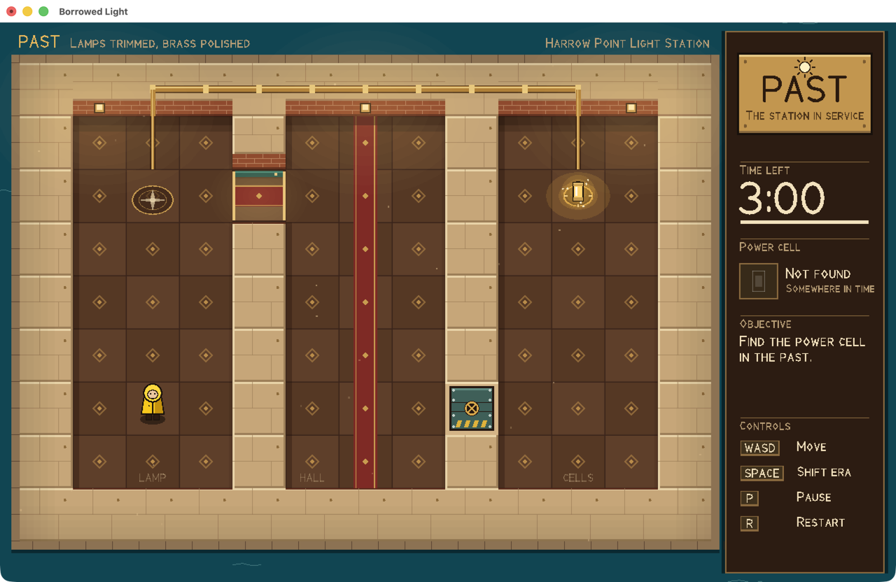
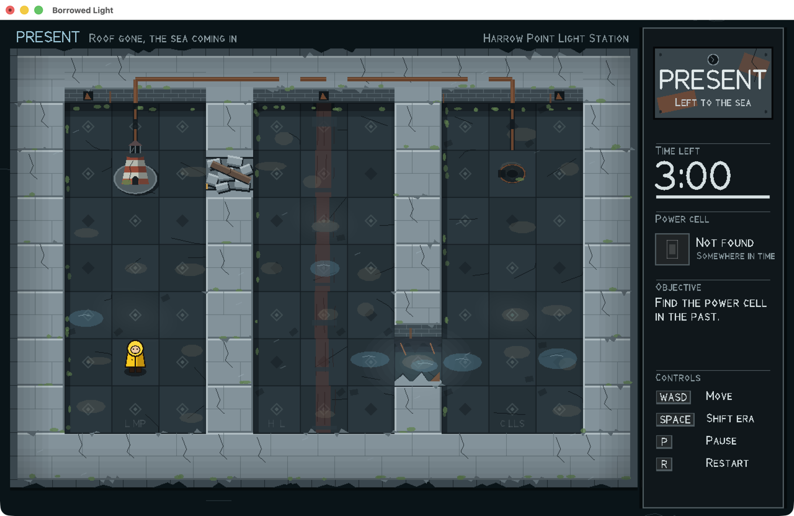

# Borrowed Light

Retrieve a power cell from the past and bring it back to illuminate a lighthouse in the present.

One complete level of a top-down time-shifting puzzle, in Haskell with Gloss. It is a practice prototype for the University of Bristol CSS GameJam 2026, kept separate from the final submission. Nothing here has been published or submitted.

Whether pre-event code is allowed in an entry, and whether this approach would qualify for the functional-programming prize, are **not established**. Check the event rules before reusing any of it.

| Past | Present |
|---|---|
|  |  |

## Run it

Needs GHC 9.6.7 and cabal-install 3.12.1.0 (`cabal.project` pins the compiler). On this machine they are in `~/.ghcup/bin`.

```bash
export PATH="$HOME/.ghcup/bin:$PATH"
```

```bash
cabal test spec --test-show-details=direct
```

```bash
cabal run borrowed-light
```

`cabal run borrowed-light -- --demo` plays the verified route, then hands you the keyboard.

### Controls

| Key | Action |
|---|---|
| WASD / arrows | Move |
| Space | Shift era |
| P | Pause / resume |
| R | Restart |
| Enter | Start / retry |
| Window close button | Exit |

### Native runtime requirements

- **macOS (tested, arm64):** Apple's GLUT and OpenGL frameworks, which ship with the OS. Both are deprecated by Apple but present.
- **Windows x64 (the team's target, not tested):** Gloss's GLUT backend needs `freeglut.dll` beside the executable or on `PATH`. See "Outstanding".

### Development flags

`--script=KEYS --after=N` runs keys instantly at startup and then freezes, to inspect an exact moment. `--trace` prints state changes and `--fps` prints frame rate. Full list at the top of [app/Main.hs](app/Main.hs).

## How it fits together

```
src/Game/   pure core: no Gloss, no IO, compiled without a graphics dependency
  Types     Era, Phase, Motion, TickInput, Level, Game
  Level     the two maps and the parser that validates them
  Logic     stepGame and tryShift: all the rules
  Input     key events into one TickInput per tick
  Fx        decorative state, derived by comparing successive games
  Solution  the intended route, and breadth-first search over real stepGame
app/        Gloss only: Main (IO), Render, Station, Figures, Hud, Title, Font, Draw, Platform
test/       plain assertions over the core
```

### The era transition

A shift is an ordinary pure function. It flips the era if the player's cell is open in the other one, and records why not if it isn't:

```haskell
tryShift level g
  | gMotion g /= Settled = g
  | walkable level destination (gCell g) =
      touchCell level cleared { gEra = destination, gMotion = Shifting shiftTicks, ... }
  | otherwise =
      cleared { gFeedback = Just (Feedback (ShiftBlocked (gCell g)) blockedFeedbackTicks) }
```

The era changes at once. `Shifting` only locks input for 13 ticks (about 0.22 s) while the wave crosses the map, so what you see and what collides can't disagree. `Motion` is a sum type (`Settled | Stepping | Shifting`), so walking and shifting at the same time can't be represented. `touchCell` is the only place pickup and victory happen, and it runs both when a step lands and when an era changes.

Each `stepGame` tick notes fresh presses, advances the current step or wave, starts what is pending (shift first, then move), then spends one tick. A win changes the phase before the tick is spent, which is why victory beats timeout on the final tick.

## Art direction

**Harrow Point Light Station**, a coastal lighthouse facility seen from above, at two times.

- **Past: kept.** Warm plaster, brick and polished brass, a red runner down the hall, lit wall lamps, dust rising in the light, calm teal water.
- **Present: left to the sea.** The same walls in cold slate with cracks and moss, the runner rotted to strips, the lamps smashed, seawater pooled on sunken floor, spray blowing the other way, dark water.

Both eras share foundations, the floor's diamond inlay, the room stencils (worn from `LAMP` to `L MP`), the conduit along the north wall, the lamp brackets, the power-cell cradle and the lighthouse's circular footing. Colour is never the only cue: the era is written above the map, named on a plaque that is polished brass in one era and corroded steel in the other, and shown in the condition of every surface.

The two opposite passages explain themselves:

| Cell | Past | Present |
|---|---|---|
| (4,2) | A door standing open, with brass thresholds and a runner through it | The lintel has fallen; a heap of rubble fills it |
| (8,6) | A bolted bulkhead with a locking wheel and hazard stripes | The sea has torn it out, leaving jagged stubs and wet floor |

Blocked cells are always bright and raised; walkable cells are always dark and flat.

**The shift** is the centrepiece: tiles flip edge-on, one by one, in order of distance from the player, behind a thin expanding ring. A refused shift outlines and hatches the cell and says why, with only a small shudder on the keeper. **Victory** moves the keeper aside, relights the tower, turns long beams through the scene and soaks warm light outward.

Everything is procedural geometry, with no external assets. Glows are layered transparency, an approximation rather than real bloom. Lettering is a custom stroke font in [app/Font.hs](app/Font.hs), because Gloss's built-in text is one pixel wide.

## Solution walkthrough

Found by breadth-first search through the real `stepGame`, and also replayed through tick inputs and OS key events.

| # | Keys | Where you end up |
|---|---|---|
| 1 | Space | Past, so the left door is open |
| 2 | D, W W W W, D D | (5,2), through the door at (4,2) |
| 3 | Space | Present, so the right wall is breached |
| 4 | S S S S, D D D D | (9,6), through the breach at (8,6) |
| 5 | Space | Past, where the cell still exists |
| 6 | W W W W, D | (10,2): cell collected |
| 7 | Space | Present, to use the breach again |
| 8 | S S S S, A A A | (7,6) |
| 9 | Space | Past, to use the door again |
| 10 | W W W W, A A A A | (3,2) |
| 11 | Space | Present |
| 12 | A | (2,2), the lighthouse: win |

36 steps and 6 shifts make 42 actions, taking 367 ticks (about 6.1 s) with no idle time.

## Evidence

### Verified: executed or directly observed here

Toolchain, on macOS 26.5.2 (arm64):

| Component | Version |
|---|---|
| GHC | 9.6.7 |
| cabal-install | 3.12.1.0 |
| gloss | 1.13.2.2 |
| gloss-rendering | 1.13.2.1 |
| GLUT (Haskell binding) | 2.7.0.16 |
| OpenGL (Haskell binding) | 3.0.3.0 |
| containers | 0.6.7 |

- **Automated tests:** all pass, covering the 18 required items plus parser, input-adapter and effects checks. Latest count: see "Test results" below.
- **Reachability in the implementation:** 255 reachable states, 0 dead ends with the countdown refilled, shortest route 42 actions with 6 shifts. This confirms the earlier abstract model. Every walkable cell in both eras can be reached, and no route uses fewer than six shifts.
- **Real window, real OS key events** (posted to the process): Enter, Space, tap, hold-to-repeat, P, R and the route to victory. Holding Space for 1 s shifted once. Space during a step shifted after landing. Keys pressed while paused were ignored.
- **Timer against the wall clock:** 616 ticks in about 10.2 s, including process launch overhead.
- **Window close:** pressing the close button through the accessibility API exits with code 0.
- **Resizing:** scales and letterboxes correctly at 900×700.
- **Visual QA:** every screen in `docs/` was captured from the running game and inspected.

### Documentation-only: documented, not tested here

- Gloss on Windows needs freeglut.
- freeglut ends the program when its window closes, by default, which is why `Platform.hs` does nothing outside macOS.

### Unverified: not established

- **Anything on Windows**, including building, linking `freeglut.dll`, key codes, window close and frame rate.
- A standalone, redistributable build on any platform.
- Prize eligibility, and whether pre-event code or AI-assisted assets are allowed.
- Physical key feel, including real auto-repeat behaviour: testing used injected events. Gloss turns GLUT key repeat off and `Game.Input` ignores repeated key-downs regardless.
- A physical mouse click on the close button: the test pressed it through accessibility.
- Keys held while the window loses focus: the key-up may never arrive, which would leave a direction held. Not tested.

## Outstanding checks on Windows

1. `cabal build`, with `freeglut.dll` available.
2. `cabal test spec`, which needs no graphics at all.
3. Play through with a real keyboard, including holding keys.
4. Close the window and confirm the process exits.
5. Check the frame rate on team laptops.

## Known issues and limitations

- **Frame rate:** 40–58 fps measured here, while other sessions were using the GPU and CPU, and about 30 fps with every core saturated. The rules are fixed-step, so the timer stayed accurate and the route still won at that load. Gloss issues one draw call per shape, so a weaker GPU may be slower. If so, reduce the dressing in `floorDressing` first.
- **Rendering is 1× on Retina Macs.** Apple's GLUT has no high-resolution mode, so the window is upscaled and edges look slightly pixelated. No anti-aliasing is available through Gloss.
- **Off-route script runs:** one of 12 scripted key-event runs left the route. A later run recorded Up moves that the script never sent, so keystrokes from outside the script reached the window, and that is the likely cause, though it is not proven for that specific run.
- **Two taps of one key inside a single tick count as one press.** That needs a stall, and did not appear under load testing.
- **`Platform.hs` uses deprecated macOS APIs and the Objective-C runtime** because Apple's GLUT disables the close button. It is the only platform-specific code.
- The optional alternate-era preview key was not added.
- There is no audio, by design.

## Asset credits

None. All art and lettering is procedural code in this repository.

## Test results

```
search: 255 reachable states, 0 dead ends
search: shortest route is 42 actions, 6 of them shifts
search: Space W W W W D D D Space S S S S D D D D Space W W W W D Space S S S S A A A Space W W W W A A A A Space A
route:  intended route takes 367 ticks, ends (Present,(2,2),True,Won)
98 passed, 0 failed
```
