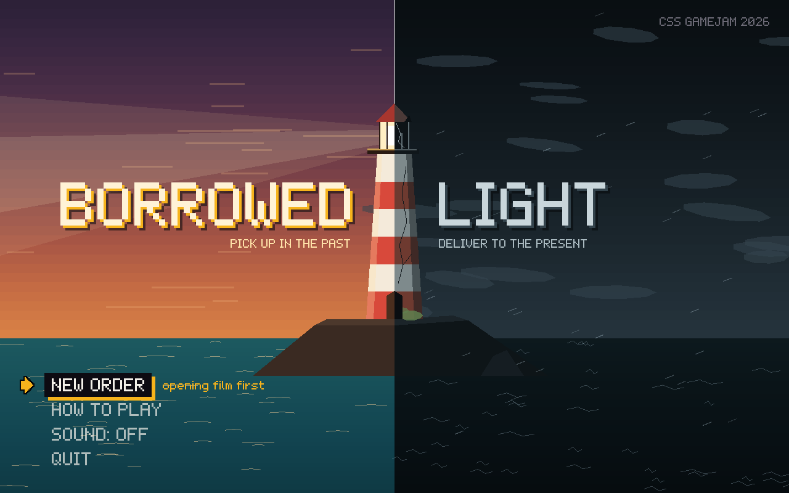
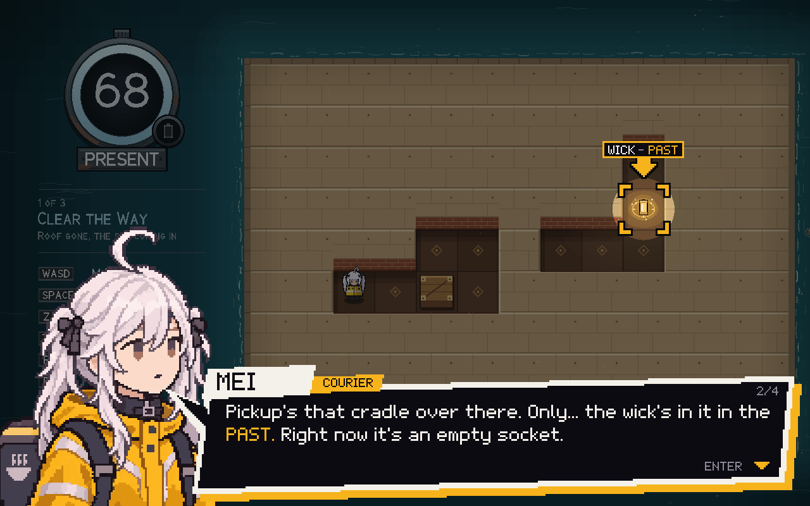
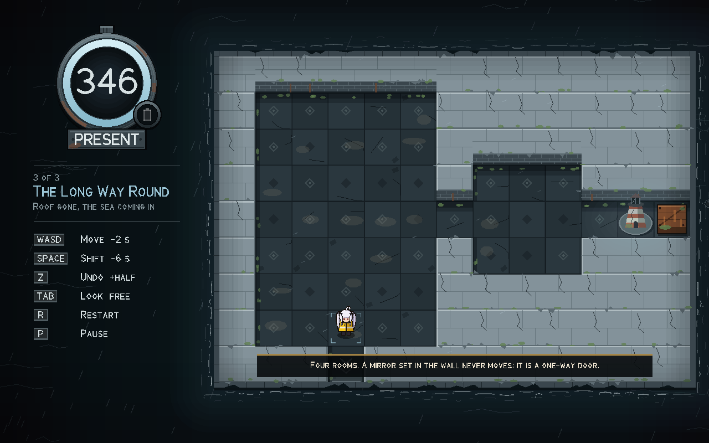
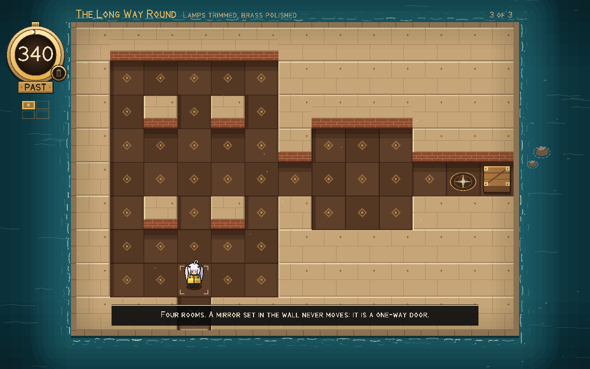
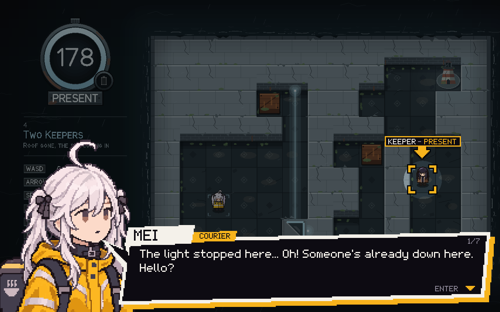
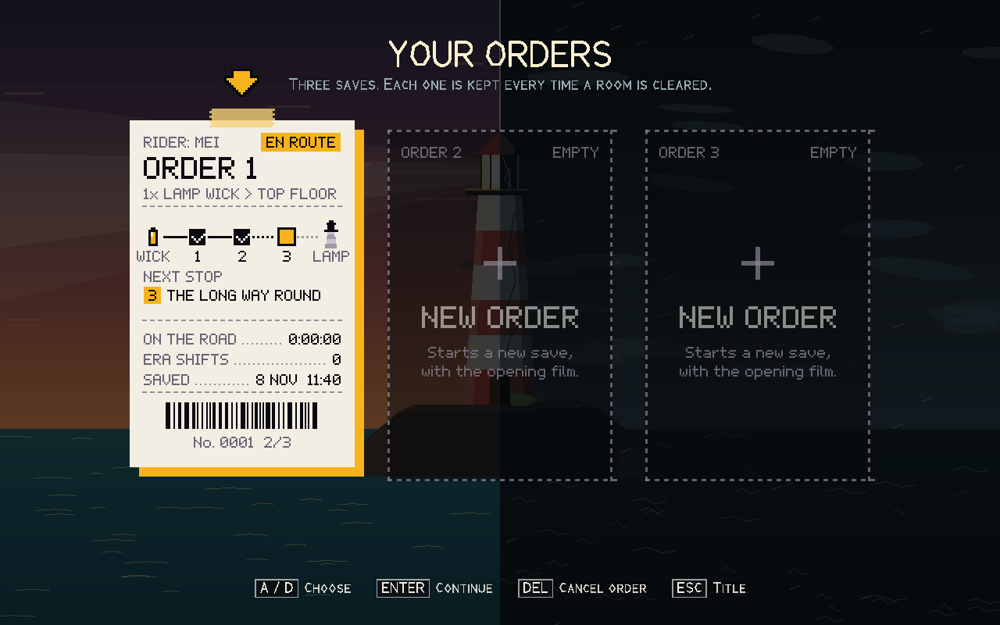
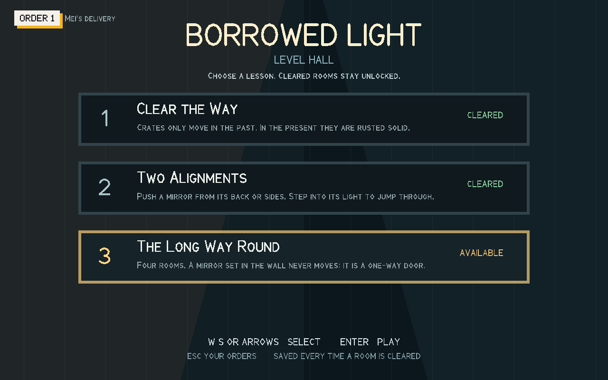

# Borrowed Light

**Pick up in the past. Deliver to the present.**

A top-down time-shifting puzzle game about a courier, a lighthouse and a clock that
never stops counting. Written in Haskell with Gloss for the University of Bristol
**CSS GameJam 2026**.



## The story

Mei rides deliveries. Tonight's order is an odd one: *pick up one lamp wick, bring it
to the top floor of Cape Lighthouse.* The catch is that the wick only exists in the
lighthouse's **past**, when someone still kept the place, and the lamp that needs it
is in the **present**, where the roof is gone and the sea is coming in.

So she does what any courier would: she flips between then and now, shoves rusted
crates while they can still slide, walks *through* mirrors, and races the clock to
get every wick home on time.



## How to play

Every level is one station, seen in two eras that share the same walls.

- **Shift era** with Space. A doorway that has fallen to rubble in the present may
  still stand open in the past; a bulkhead bolted shut in the past may have been torn
  out by the sea. You can only shift where the other era has floor under your feet.
- **Fetch the wick** from the past and carry it to the **lamp** in the present.
- **Time is a budget, not a timer.** Standing still is free; every action costs
  seconds: a step 2, a shift 6, a mirror jump 4. Run out and the delivery is late.
- **Crates** slide only in the past. In the present they are rusted to the floor. A
  crate stands in both eras, so moving it in one can open a way in the other, or fill
  a pit to make a bridge.
- **Mirrors** throw a beam of light. Stand in it and walk at the glass, and you come
  out as far behind the mirror as you stood in front of it. Mirrors on a sled can be
  pushed from the back or sides; mirrors set in the wall never move, and corner
  mirrors turn you round a corner.
- **The game helps without telling you the answer.** Hold Tab to look at the other
  era for free, Z undoes an action for half its price back, the board shows where a
  push or a jump would take you before you commit, and a warning appears the moment a
  push makes the level impossible.

| Present | Past |
|---|---|
|  |  |

### Controls

| Key | Action |
|---|---|
| WASD / arrow keys | Move (walk into a crate or a sled mirror to push it) |
| Space | Shift era |
| Tab (hold) | Look at the other era, for free |
| Z | Undo the last action (refunds half its time) |
| R | Restart the level |
| P | Pause |
| M | Sound on / off |
| Enter | Choose a menu line; continue the dialogue (Space too) |
| Enter (hold) | Skip the opening film |
| Escape | Back: level → level hall → your orders → title |
| Delete / Backspace | On the orders screen: cancel an order (then hold Enter to tear it up) |

### The levels

| # | Level | What it teaches |
|---|---|---|
| 1 | Clear the Way | Crates move only in the past; two passages open in opposite eras |
| 2 | Two Alignments | Push a mirror on its sled, then step through its light, twice |
| 3 | The Long Way Round | Four rooms shown one at a time, two routes through each, and a mirror in the wall that is a one-way door |

Every level is checked by the game's own solver, which plays it through the real
rules: the test suite proves each one can be won within its budget and reports its
par.

<details>
<summary><b>Spoiler: what happens after level 3</b></summary>

Lighting the third lamp looks like the end: every order delivered, five stars. Then
the lamp goes out, its light breaks a path straight out through the walls, and Mei
follows it to the real lighthouse, where its keeper is waiting.

The last level, **Two Keepers**, is hidden from the level hall. It is for **two
players on one keyboard**: Mei on WASD, the keeper on the arrow keys, sharing one
clock and one era (Space shifts both). Two islands, water between them, and corner
mirrors that only carry you across one way. Neither keeper can finish it alone, and
the solver's two-player search in the tests proves exactly that.



</details>

### Saves

Your progress is kept as one of three **orders**, drawn as delivery tickets: the
route from wick to lamp, the next stop, time on the road and era shifts. A room
cleared is saved at once. Cleared rooms stay unlocked in the **Level Hall** to
replay.

| Your orders | Level hall |
|---|---|
|  |  |

Saves live in `borrowed-light/` under the user data folder (`%APPDATA%` on Windows,
`~/.local/share` on macOS and Linux). Set `XDG_DATA_HOME` to an empty folder to try
a first run without touching your own save.

## Build and run

You need **GHC 9.6.7** and **cabal-install 3.12** (`cabal.project` pins the
compiler). The easiest way to get both is [GHCup](https://www.haskell.org/ghcup/).
Everything else, including two lightly patched copies of Gloss in `vendor/`, is
built by cabal.

```bash
cabal run borrowed-light
```

```bash
cabal test spec --test-show-details=direct
```

| Platform | Notes |
|---|---|
| **Windows 10/11 x64** | The main target. No extra DLLs: the window uses GLFW, compiled in, and sound plays through `waveOut`. |
| **macOS (Apple Silicon tested)** | Uses the system OpenGL and AudioToolbox frameworks. Sound plays through AudioQueue. |
| **Linux** | Needs freeglut installed (for example `libglut` / `freeglut3-dev`). Runs, but silently: there is no Linux sound output yet. |

On Windows, if you use VS Code, [docs/vscode-setup.md](docs/vscode-setup.md) sets
up the build and run tasks.

### Command-line options

| Option | What it does |
|---|---|
| `--fullscreen` | Fill the primary monitor |
| `--mute` | Start with the sound off |
| `--intro` | Watch the opening film again |
| `--demo` | Let the solver play every level, then hand you the keyboard (`--pace=N` slows it down) |
| `--level=N` | Unlock up to level N and select it (`--level=4` opens the hidden level) |

Development flags (`--script`, `--trace`, `--fps`, `--dump-sounds=DIR`, …) are
listed at the top of [app/Main.hs](app/Main.hs).

## How it is made

- **A pure core, a thin shell.** All the rules, the story beats, the sound cues and
  the save desk are pure Haskell in [src/Game/](src/Game/), with no graphics
  dependency. Gloss, audio and files live only in [app/](app/). That split is what
  lets the tests replay whole levels tick by tick.
- **A solver in the test suite.** A cheapest-first search over the real `stepGame`
  derives every level's par, and a second, compact search finds every dead state so
  the game can warn the moment a level becomes unwinnable. It runs a slice per frame
  in the background, so play never waits for it.
- **Everything drawn and heard is code.** The tiles, the sea, the pocket-watch HUD
  and the lettering are procedural geometry. Every sound effect and ambient bed is
  synthesised at startup from oscillators, noise and filters
  ([app/Synth.hs](app/Synth.hs)) and mixed by a small C mixer on its own thread
  ([cbits/audio.c](cbits/audio.c)). The ending's score is timed to the picture,
  tick for tick.
- **Its own film format.** The opening film is stored in a palette-and-delta format
  made for this game ([app/Video.hs](app/Video.hs)), encoded by a Blender script in
  [tools/](tools/).

```
src/Game/   the pure core: rules, levels, solver, story, sound cues, saves
app/        the Gloss shell: drawing, HUD, title, talk box, film, synth, audio, save files
cbits/      the sound mixer (waveOut / AudioQueue) and the input-method fix for Windows
assets/     the opening film; source art for the portraits
tools/      Blender scripts that encode the film and the portraits
test/       456 assertions over the core, including every level's solution
vendor/     Gloss and gloss-rendering, patched for speed and Windows stability
docs/       screenshots, design mockups and the full design notes
```

For the full detail of every rule, screen, sound and decision, see
**[docs/design-notes.md](docs/design-notes.md)**.

## Team

Made for CSS GameJam 2026 by:

- Bryce Jing
- Chaeyeon Park
- Harrison Hui
- Shengyu Wang
- Tom Rick
- Yuzhe Jia

## Credits

- The opening film and the portraits of Mei and the lighthouse keeper were made for
  the game by the team. Everything else you see and hear, art, lettering and sound,
  is generated by the code in this repository.
- [Gloss](https://hackage.haskell.org/package/gloss) and gloss-rendering by the Gloss
  Development Team (MIT licence), vendored with small patches marked
  "Patched for Borrowed Light".
